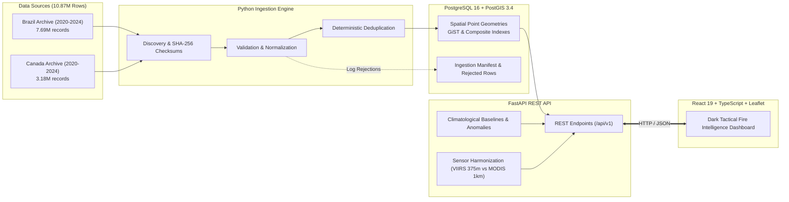

# Fire Intelligence Platform

[](https://www.python.org/)
[](https://fastapi.tiangolo.com/)
[](https://www.postgresql.org/)
[](https://postgis.net/)
[](https://react.dev/)
[](https://www.typescriptlang.org/)

An enterprise-grade geospatial wildfire intelligence platform that ingests, audits, and analyzes historical NASA FIRMS satellite observations (VIIRS 375m & MODIS 1km), computes multi-year climatological baseline statistics, detects seasonal anomalies, and serves a dark tactical geospatial operations dashboard.

---

## 1. System Architecture

The platform is designed as a high-performance **modular monolith** with clear separation of concerns across data engineering, spatial persistence, analytical compute, and frontend presentation:



---

## 2. Directory Structure

```text
NASA/
├── Recreate Dark Enterprise Dashboard/  # Existing React 19 + TypeScript + Leaflet frontend
│   ├── src/
│   │   ├── services/apiClient.ts        # Typed API client querying backend
│   │   ├── services/fireService.ts      # Active fire layer with live API integration
│   │   ├── components/Navbar.tsx        # Topbar with live PostGIS connection badge
│   │   ├── components/ActivityCalendar.tsx # Real daily observation heatmap
│   │   └── components/AnomalyChart.tsx  # Multi-year climatological anomaly curve
│   └── package.json
├── backend/                             # Python 3.12 FastAPI service & Ingestion CLI
│   ├── app/
│   │   ├── api/routes/                  # Health, Fires, Regions, Analytics, Ingestion
│   │   ├── core/                        # Configuration & logging
│   │   ├── db/                          # SQLAlchemy models & PostGIS schema
│   │   ├── ingestion/                   # Production CSV ingestion engine
│   │   ├── repositories/                # Spatial PostGIS repository
│   │   ├── services/                    # Analytics, Harmonization, Weather, ML
│   │   ├── cli.py                       # Typer CLI management tool
│   │   └── main.py                      # FastAPI application entrypoint
│   ├── tests/                           # 22 automated unit & integration tests
│   ├── docker-compose.yml               # PostgreSQL 16 + PostGIS 3.4 setup
│   └── requirements.txt
├── brazil/                              # Historical NASA FIRMS Brazil CSVs (2020–2024)
├── canada/                              # Historical NASA FIRMS Canada CSVs (2020–2024)
├── docs/                                # Technical documentation suite
│   ├── architecture.md                  # Comprehensive architectural specification
│   ├── database-schema.md               # Database tables, ERD, and spatial indexes
│   ├── data-quality-report.md           # Audit findings across all 10.87M rows
│   ├── data-dictionary.md               # Attribute definitions, units, and ranges
│   ├── data-ingestion.md                # Ingestion manual, CLI options, and deduplication
│   └── api.md                           # REST API endpoint documentation & schemas
├── .env.example                         # Root configuration template
└── README.md
```

---

## 3. Quickstart Guide

### Step 1: Start PostgreSQL with PostGIS
Ensure Docker Desktop is running, then start the spatial database container:
```powershell
cd c:\Users\Dell\Desktop\NASA\backend
docker compose up -d
```
Verify the container is healthy:
```powershell
docker compose ps
```

### Step 2: Set Up Python Backend Environment
```powershell
# In backend/ directory, create a Python 3.12 virtual environment (e.g. using uv)
uv venv --python 3.12 .venv

# Activate environment
.\.venv\Scripts\Activate.ps1

# Install requirements
uv pip install -r requirements.txt

# Run migrations and seed countries, regions, and sensor metadata
.\.venv\Scripts\python.exe -m alembic upgrade head
.\.venv\Scripts\python.exe -m app.db.init_db
```

### Step 3: Audit and Ingest Satellite Datasets
Use the ingestion CLI to inspect and import NASA FIRMS observations:
```powershell
# 1. Audit datasets across brazil/ and canada/
.\.venv\Scripts\python.exe -m app.cli audit

# 2. Validate data quality
.\.venv\Scripts\python.exe -m app.cli validate

# 3. Check status
.\.venv\Scripts\python.exe -m app.cli status

# 4. Ingest sample batch (e.g. 10,000 rows for immediate development)
.\.venv\Scripts\python.exe -m app.cli ingest --country BR --max-rows 5000
.\.venv\Scripts\python.exe -m app.cli ingest --country CA --max-rows 5000

# Or ingest full multi-year archives (10.87M rows):
.\.venv\Scripts\python.exe -m app.cli ingest --all
```

### Step 4: Run the FastAPI Backend Server
```powershell
.\.venv\Scripts\python.exe -m uvicorn app.main:app --host 0.0.0.0 --port 8000 --reload
```
Check operational status:
- Health Endpoint: [http://localhost:8000/api/v1/health](http://localhost:8000/api/v1/health)
- Database & PostGIS Status: [http://localhost:8000/api/v1/health/database](http://localhost:8000/api/v1/health/database)
- Interactive Swagger UI: [http://localhost:8000/docs](http://localhost:8000/docs)

### Step 5: Start the React Frontend Dashboard
In a separate terminal:
```powershell
cd "c:\Users\Dell\Desktop\NASA\Recreate Dark Enterprise Dashboard"
cmd.exe /c npm run dev
```
Open [http://localhost:5173](http://localhost:5173) in your browser.

---

## 4. Automated Testing

The backend includes a comprehensive pytest suite covering CSV ingestion, time normalization, confidence mapping, spatial point creation, bounding-box queries, and historical anomaly calculations:

```powershell
cd c:\Users\Dell\Desktop\NASA\backend
.\.venv\Scripts\python.exe -m pytest tests -v
```
**Results:** `22 passed in 0.48s`.

---

## 5. Key Documentation References

For in-depth technical details, refer to the documentation in `docs/`:
- [Architecture Specification](file:///c:/Users/Dell/Desktop/NASA/docs/architecture.md)
- [Database Schema & ERD](file:///c:/Users/Dell/Desktop/NASA/docs/database-schema.md)
- [Data Quality Audit Report](file:///c:/Users/Dell/Desktop/NASA/docs/data-quality-report.md)
- [Data Dictionary & Units](file:///c:/Users/Dell/Desktop/NASA/docs/data-dictionary.md)
- [Data Ingestion Guide & CLI](file:///c:/Users/Dell/Desktop/NASA/docs/data-ingestion.md)
- [FastAPI REST API Specification](file:///c:/Users/Dell/Desktop/NASA/docs/api.md)
