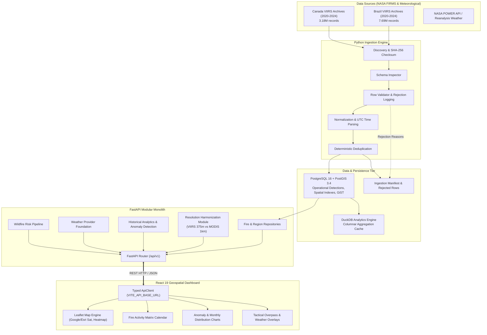

# System Architecture — Fire Intelligence Platform

The **Fire Intelligence Platform** is a geospatial wildfire intelligence system that ingests historical satellite thermal anomaly detections, visualizes active wildfire activity, analyzes historical climatological patterns, detects seasonal anomalies, harmonizes multi-sensor resolutions, and serves tactical alerts to dashboard clients.

---

## 1. High-Level Architecture Diagram

---

## 2. Component Architecture

### 2.1 Storage Tier
1. **PostgreSQL 16 with PostGIS 3.4:**
   - Primary operational store for transactional queries, pagination, bounding box spatial queries, polygon filtering, and data provenance.
   - Spatial indexing via `GiST` on `geometry(Point, 4326)`.
   - B-Tree indexes on `acq_date`, `country_code`, `frp`, and composite indexes for common dashboard filters.
2. **DuckDB & Columnar Analytics:**
   - Embedded fast columnar query engine capable of scanning millions of rows in sub-second latency for complex multi-year climatological baseline statistics.

### 2.2 Backend Application (FastAPI)
- **FastAPI + Pydantic v2:** High-speed asynchronous web framework with strict request/response data validation and auto-generated OpenAPI documentation.
- **SQLAlchemy 2.x:** Modern ORM utilizing connection pooling (`pool_pre_ping=True`, `max_overflow=25`).
- **Alembic:** Declarative database migration tracking.
- **Resolution Harmonization Module:** Aggregates multi-resolution thermal anomalies (VIIRS 375m and MODIS 1km) into a configurable equal-area spatial grid cell without arbitrary scaling or fake calibrations.
- **Weather Foundation:** Abstract `WeatherProvider` interface supporting NASA POWER, Open-Meteo, and calibrated climatological fallbacks.
- **Machine Learning Foundation:** Modular feature engineering and risk scoring pipeline with temporal splits.

### 2.3 Frontend Integration (React 19 + TypeScript)
- Modular dashboard adhering to dark geospatial SOC aesthetics.
- Typed `ApiClient` with configurable `VITE_API_BASE_URL`.
- Live database connectivity status indicator badge in the topbar.
- Consistent global filtering: selecting a country or date automatically cascades across the Leaflet map, Activity Calendar, Anomaly Curve, and Summary Cards.
