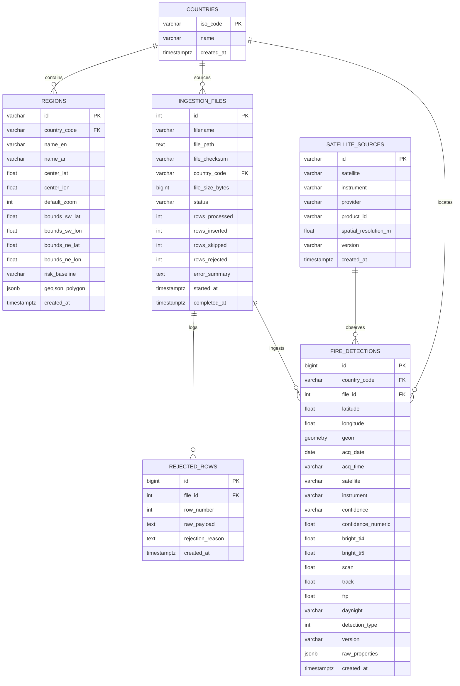

# Database Schema & Spatial Architecture

The platform uses **PostgreSQL 16** with the **PostGIS 3.4** spatial extension. Coordinates are projected in **WGS 84 (EPSG:4326)**.

---

## 1. Entity-Relationship Model

---

## 2. Table Specifications & Indexes

### 2.1 `countries`
- **Primary Key:** `iso_code` (`VARCHAR(3)`) e.g. `'BRA'`, `'CAN'`.
- **Fields:** `name` (`VARCHAR(100)`), `created_at` (`TIMESTAMPTZ`).

### 2.2 `regions`
- **Primary Key:** `id` (`VARCHAR(50)`) e.g. `'brazil'`, `'canada'`, `'mediterranean'`.
- **Spatial Bounds:** `bounds_sw_lat`, `bounds_sw_lon`, `bounds_ne_lat`, `bounds_ne_lon`.
- **Polygon Boundary:** `geojson_polygon` (`JSONB`).

### 2.3 `satellite_sources`
- **Primary Key:** `id` (`VARCHAR(50)`) e.g. `'VIIRS_N20'`, `'MODIS_AQUA'`.
- **Fields:** `satellite`, `instrument`, `provider`, `spatial_resolution_m`, `version`.

### 2.4 `ingestion_files`
- **Primary Key:** `id` (`SERIAL`).
- **Unique Fingerprint:** `file_checksum` (`VARCHAR(64)` SHA-256).
- **Status State Machine:** `PENDING` ➔ `PROCESSING` ➔ `COMPLETED` | `FAILED`.
- **Row Counters:** `rows_processed`, `rows_inserted`, `rows_skipped`, `rows_rejected`.

### 2.5 `rejected_rows`
- **Primary Key:** `id` (`BIGSERIAL`).
- **Foreign Key:** `file_id` references `ingestion_files(id)` with `ON DELETE CASCADE`.
- **Fields:** `row_number`, `raw_payload`, `rejection_reason`.

### 2.6 `fire_detections`
- **Primary Key:** `id` (`BIGSERIAL`).
- **Geographic Coordinates:** `latitude` (`FLOAT`), `longitude` (`FLOAT`).
- **PostGIS Column:** `geom` (`geometry(Point, 4326)`).
- **Observations:** `acq_date` (`DATE`), `acq_time` (`VARCHAR(4)` HHMM UTC).
- **Thermal Radiative Attributes:** `frp` (`FLOAT` in MW), `bright_ti4` (`FLOAT` in K), `bright_ti5` (`FLOAT` in K).
- **Quality & Context:** `confidence`, `confidence_numeric` (0-100%), `daynight` (`D`/`N`), `detection_type` (0=vegetation, 1=volcano, 2=industrial, 3=offshore).

---

## 3. Performance Indexes

1. **Spatial GiST Index:** `CREATE INDEX idx_fire_detections_geom ON fire_detections USING GIST (geom);`
2. **Temporal B-Tree Index:** `CREATE INDEX idx_fire_detections_acq_date ON fire_detections (acq_date);`
3. **Composite Country & Date Index:** `CREATE INDEX ix_fire_detections_country_date ON fire_detections (country_code, acq_date);`
4. **Composite Date & FRP Index:** `CREATE INDEX ix_fire_detections_date_frp ON fire_detections (acq_date, frp);`
5. **Deduplication Composite Index:** `CREATE INDEX ix_fire_detections_dedup ON fire_detections (latitude, longitude, acq_date, acq_time, satellite);`
